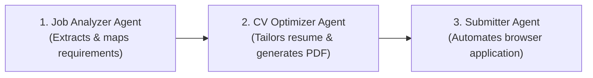

# cvHandler

An end-to-end autonomous multi-agent pipeline built with **LangGraph**, **Google Gemini (Gemini 3.8 Flash)**, **WeasyPrint**, and **browser-use** to analyze job postings, generate tailored ATS-friendly resumes, and automatically submit job applications via browser automation.

---

## Architecture & Workflow

The pipeline operates as a directed acyclic graph (DAG) maintaining a shared state (`AgentState`) passing across three dedicated nodes:



1. **Job Analyzer Agent (`job_analyzer_node`)**:
   - Ingests the job posting (URL or raw text) and the candidate's base profile (`profile.json`).
   - Uses **Gemini 2.0 Flash** with Pydantic structured output (`JobAnalysisOutput`) to extract required hard skills, soft skills, company details, and candidate match points.
   - **Guiding Rule**: Strict prohibition against fabricating skills or experiences the user does not possess.

2. **CV Optimizer Agent (`cv_optimizer_node`)**:
   - Combines the candidate's verified profile with the job requirements.
   - Rewrites project descriptions and bullet points to emphasize relevant match points and keywords.
   - Produces responsive, clean HTML/CSS and compiles it into an A4 PDF (`/tmp/cv_ready.pdf`) using **WeasyPrint**.

3. **Executor / Submitter Agent (`submitter_node`)**:
   - Operates a Chromium browser session using **`browser-use`** powered natively by **Gemini 2.0 Flash** (multimodal vision support).
   - Navigates to the job portal, fills out text fields (contact details, URLs), uploads the freshly compiled PDF resume, and accepts required privacy agreements.
   - Safely pauses and flags for manual intervention if blockers such as CAPTCHA or 2FA are detected.

---

## Project Structure

```text
cvHandler/
├── architecture.md     # Full design specification and agent prompt guidelines
├── state.py            # Pydantic schemas & LangGraph AgentState TypedDict
├── agents.py           # Implementation of Analyzer, Optimizer, and Submitter nodes (Gemini)
├── main.py             # LangGraph StateGraph builder, profile loader & async entrypoint
├── requirements.txt    # Project dependencies
├── .env.example        # Example environment variables template
├── .gitignore          # Git exclusion rules (.venv, .env, PDFs, caches)
└── README.md           # Project documentation
```

---

## Prerequisites

- **Python**: 3.10+ (tested on Python 3.12 and 3.13)
- **Google Gemini API Key**: 100% Free via [Google AI Studio](https://aistudio.google.com/).
- **macOS System Libraries** (for WeasyPrint):
  WeasyPrint requires Cairo and Pango. If you are on macOS, ensure Pango is installed via Homebrew:
  ```bash
  brew install pango
  ```
  *(Note: `agents.py` includes automatic library resolution for Apple Silicon Homebrew paths).*

---

## Installation & Setup

1. **Clone the repository**:
   ```bash
   git clone https://github.com/riccardoranazziPolito/cvHandler.git
   cd cvHandler
   ```

2. **Create and activate a virtual environment**:
   ```bash
   python3 -m venv .venv
   source .venv/bin/activate
   ```

3. **Install dependencies**:
   ```bash
   pip install -r requirements.txt
   ```

4. **Install Playwright browser binaries** (for `browser-use`):
   ```bash
   playwright install chromium
   ```

5. **Configure Environment Variables**:
   Create a `.env` file in the root directory (or copy from `.env.example`):
   ```bash
   cp .env.example .env
   ```
   Add your free Google Gemini API key:
   ```env
   GEMINI_API_KEY="your-gemini-api-key-here"
   ```

---

## Usage

### 1. Configure Candidate Profile
On first run, `main.py` will automatically generate a sample `profile.json` if it does not already exist. You can update this file with your actual background:

```json
{
  "personal_info": {
    "first_name": "Mario",
    "last_name": "Rossi",
    "email": "mario.rossi@example.com",
    "phone": "+39 333 1234567",
    "linkedin": "https://linkedin.com/in/mariorossi",
    "github": "https://github.com/mariorossi"
  },
  "experiences": [
    {
      "role": "AI & Data Engineering Intern",
      "company": "DataLab Srl",
      "period": "2025 - 2026",
      "description": "Developed distributed PySpark pipelines and ML models in Python."
    }
  ],
  "education": [
    {
      "degree": "M.Sc. in Computer Engineering",
      "institution": "Politecnico di Torino",
      "year": "2026"
    }
  ],
  "skills": ["Python", "PySpark", "Machine Learning", "Docker", "SQL"]
}
```

### 2. Run the Pipeline
Run the main script:

```bash
python main.py
```

### 3. Execution Flow & Output
1. The **Job Analyzer** extracts requirements and logs the matching points using Gemini.
2. The **CV Optimizer** writes and renders the tailored resume to:
   ```
   /tmp/cv_ready.pdf
   ```
3. The **Submitter Agent** opens the browser, uploads `/tmp/cv_ready.pdf`, fills the fields, and clicks apply.
4. The final graph state is printed to stdout in JSON format, indicating the `submission_status` (`SUCCESS`, `REQUIRES_MANUAL_INTERVENTION`, or `FAILED`).

---

## Disclaimer

This project is intended for educational and personal automation purposes. Always verify company application terms and ensure review of generated resumes before automated submission.
